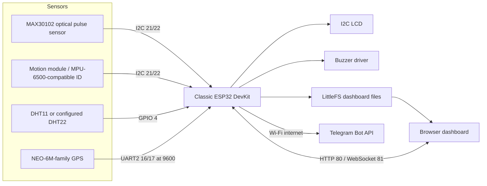

# System Architecture

## Overview

The classic ESP32 is the central controller. It reads sensor data, updates local outputs, serves the dashboard from LittleFS, and attempts Telegram notifications when configured alert conditions are active.

## Architecture diagram

## Runtime data flow

1. The MAX30102 FIFO is sampled for optical heart-rate estimation and SpO₂ algorithm input.
2. DHT measures ambient temperature and relative humidity.
3. The motion module's registers are read directly. The tested module returned WHO_AM_I `0x70`; the firmware accepts `0x70` and `0x68`.
4. GPS NMEA data is parsed over UART2. Coordinates are shown only when the location is valid and recent.
5. The LCD shows compact local status; the buzzer is driven by the alert logic.
6. LittleFS serves `/index.html`, `/style.css`, and `/script.js`. HTTP runs on port 80, WebSocket on port 81, and `/api/data` provides a JSON snapshot.
7. Telegram messages are attempted over Wi-Fi when alert conditions change. A map link is included when a GPS fix is available.

## Current firmware thresholds

- Heart rate greater than 100 BPM or less than 60 BPM when a valid reading exists.
- SpO₂ estimate below 95% when valid.
- Ambient temperature greater than 37 °C.
- Relative humidity greater than 85%.
- Possible-fall heuristic: acceleration magnitude at least 3.0 g after an 8-second startup guard, followed by a stillness window of about 2 seconds.
- The demo possible-fall state clears after 10 seconds.

These are code settings for a student prototype, not validated clinical or safety thresholds. They require careful testing and may produce false positives and false negatives.

## Configuration

Copy `firmware/secrets.h.example` to `firmware/secrets.h`, then set the Wi-Fi SSID/password and Telegram bot token/chat ID locally. The actual secrets file is ignored by Git.

## Limitations

- DHT reports ambient conditions, not body temperature.
- MAX30102 readings depend on sensor fit, contact, motion, and signal quality. Do not treat readings as medical measurements.
- Fall detection is a simple heuristic, not a validated algorithm. Clearing an alert does not prove safety.
- GPS reception may be poor indoors and can require several minutes for a fix.
- Telegram requires working internet access. Current prototype TLS configuration does not validate the server certificate.
- This system is not a medical device and must not be relied on as the sole emergency monitoring system.
